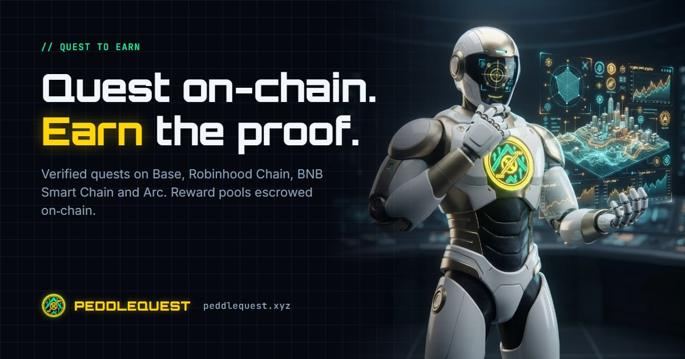

<!-- Source of truth: peddles-quest/design/github-profile/profile/README.md,
     published to github.com/peddlequest/.github. Edit there, not here. -->

  

<h3 align="center">Quest on-chain. Earn the proof.</h3>

  Verified quests on <b>Base</b>, <b>Robinhood Chain</b>, <b>BNB Smart Chain</b> and <b>Arc</b>,
  with every reward pool escrowed on-chain before a quest goes live.

  
  
  
  
  

---

## What PeddleQuest is

PeddleQuest is a quest platform. Projects post tasks, questers complete them,
and the winners are paid on chain from a pool the project locked up front.
A quest cannot go live until its reward pool is held by the escrow contract,
and the server checks that on chain before it publishes. Staff cannot
override it.

## Features

| | |
|---|---|
| 🔒 **Escrowed reward pools** | Every quest's pool sits in `PeddlesQuestEscrow` before the quest opens. Winners get exactly the advertised pool, and the deposit fee is charged on top of it. |
| 🧾 **Verifiable payouts** | Before each payout root is published, the winner list is pinned to IPFS. Anyone can recompute the root and compare it with the contract. |
| 🚪 **No stuck funds** | Payments are pulled, not pushed, and expiry sweeps are permissionless. No single address, the owner included, can block anyone from being paid. |
| ✅ **Verified tasks** | On-chain token, DEX swap and liquidity tasks are checked over RPC, plus Telegram, Discord and X tasks, quizzes and visits. |
| 🛡️ **Sybil rules** | Creators set eligibility rules that are checked live when someone joins and fail closed. A wallet can pass a quest's rules for one account only. |
| 🏅 **Soulbound badges** | Completion badges are minted by `PeddlesQuestBadge`. |
| 📣 **Share-to-earn** | Shared quest links carry a referral, and a referred quester's verified task earns the referrer XP. Every quest link previews its own share card. |
| 🧩 **Embeddable widgets** | Quest, leaderboard and live-quest widgets go on any site with one script tag. |
| 📈 **Promotion** | Trending and banner slots are bought on chain, and promoted quests are always labelled "Promoted". |
| 📱 **Telegram Mini App** | The full app runs inside Telegram. |

## Chains

| Chain | Chain ID | Native coin |
|---|---|---|
| Base | 8453 | ETH |
| Robinhood Chain | 4663 | ETH |
| BNB Smart Chain | 56 | BNB |
| Arc | 5042 | USDC |

## Contracts

The addresses are the same on all four chains. The contracts are immutable,
with no proxies, and their source is verified on Sourcify. Owner and
treasury are a 2-of-3 Safe.

| Contract | Address |
|---|---|
| `PeddlesFeeRouter` | `0x0c90BD0A17879C9b627705206522020078C51231` |
| `PeddlesQuestEscrow` | `0x16267bE6D067b3d411bf779B5aD041f9eba4CadE` |
| `PeddlesPromotionMarket` | `0x704E5eA6752EbfcEDB377512b67c0138461f4849` |
| `PeddlesQuestBadge` | `0x6DA219d4072A91665F702e34ca6CcaCd3eA7AE91` |

> [!IMPORTANT]
> **These contracts have not been audited yet.** An external audit is planned.
> Until it lands, each quest's deposit is capped to limit exposure.
> [peddlequest.xyz/contracts](https://peddlequest.xyz/contracts) reads the live
> state of each contract straight from the chain.

## Fees

| | Today | Permanent cap |
|---|---|---|
| Quest creation | free | $50 |
| Deposit fee (on top of the pool) | 3% | 10% |
| Unclaimed pool to treasury | 20% | 50% |
| Badge mint | $0.30 | $10 |
| Trending / banner slot | $3 per day | $500 per day |

The caps are set once per chain at deploy, and nobody can raise them.

## Build on PeddleQuest

- **Developers:** [docs.peddlequest.xyz/integrations/sdk](https://docs.peddlequest.xyz/integrations/sdk) has the SDK, and [embed](https://docs.peddlequest.xyz/integrations/embed) has the widgets.
- **Project owners:** [docs.peddlequest.xyz/owners/getting-started](https://docs.peddlequest.xyz/owners/getting-started) covers running a quest and funding the pool.
- **Questers:** [docs.peddlequest.xyz/users/getting-started](https://docs.peddlequest.xyz/users/getting-started) covers joining, verifying and claiming.

---

  Built by <a href="mailto:team@gullylabs.xyz">Gully Labs LLC</a> · 18+ · <a href="https://peddlequest.xyz/terms-and-condition">Terms</a> · <a href="https://peddlequest.xyz/privacy-policy">Privacy</a>

